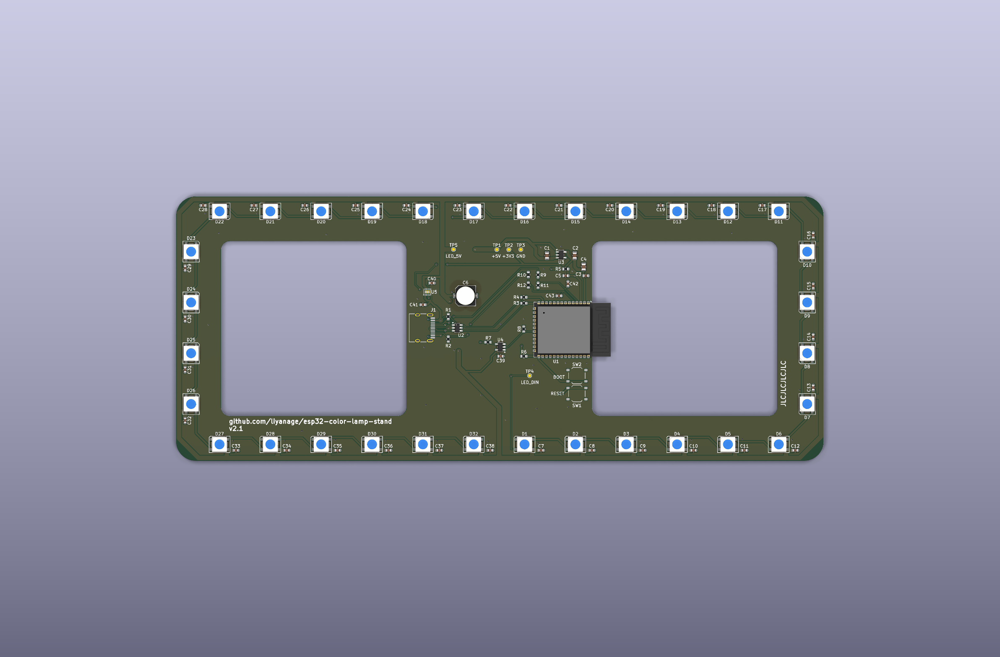

# Modifying the Color Lamp Stand

This guide is for you and any AI coding agent helping you customize your stand.
The main [README](README.md) explains how to use it without changing anything.

Software is the easiest place to experiment; no soldering or PCB changes are
needed. First prove that you can build and flash the existing software unchanged.
That separates toolchain and USB problems from problems in your new code, and
gives you a known-good starting point to return to.

## Software

### First checkpoint: build and flash unchanged

You need a Mac, Git, and a **USB-C data
cable**. A charge-only cable can power the LEDs but cannot program the stand.
Connect directly to your Mac for this checkpoint, and disconnect other
ESP32 boards so you cannot accidentally flash the wrong one.

An agent needs a local checkout and access to your computer's USB port to flash
the stand. A cloud-only agent can edit the code but cannot flash your connected
device; you will need to run that step locally.

#### 1. Install and activate ESP-IDF

The tested build environment for this firmware is **ESP-IDF v6.0.2**, targeting
**ESP32-S3**. Start with that exact version rather than upgrading the SDK at the
same time as customizing the code. ESP-IDF includes the compiler, CMake, Ninja,
Python environment, and device-programming tools; installing Python or an
Arduino IDE alone is not sufficient.

Follow the macOS instructions in [Espressif's ESP32-S3 installation guide for v6.0.2](https://docs.espressif.com/projects/esp-idf/en/v6.0.2/esp32s3/get-started/index.html).
Its recommended installer is the **ESP-IDF Installation Manager (EIM)**. Select
v6.0.2 and install the tools needed for ESP32-S3.

Open an activated terminal for that installation before running any commands:

- With EIM, select the installed version and choose **Open IDF Terminal**, or
  run the activation command provided by the installer.
- With a legacy installation, source `export.sh` from your actual
  ESP-IDF installation, for example
  `. "$HOME/esp/esp-idf-v6.0.2/export.sh"`. This example path is not required;
  use wherever you installed ESP-IDF.

See the official [macOS command-line guide](https://docs.espressif.com/projects/esp-idf/en/v6.0.2/esp32s3/get-started/linux-macos-start-project.html)
for more detail.
Activation applies to that terminal session, not every terminal on the computer.
An agent launching a separate shell must activate the same installation in its
own execution environment too.

Check the active SDK:

```sh
idf.py --version
```

It should report **ESP-IDF v6.0.2**. If the command is missing or reports another
version, fix the environment before changing the firmware. On Apple Silicon,
use a native ARM64 terminal and matching toolchain rather than mixing Rosetta
and native tools.

#### 2. Get the repository and build it

Clone into a location whose full path contains no spaces:

```sh
git clone https://github.com/liyanage/esp32-color-lamp-stand.git
cd esp32-color-lamp-stand
git status --short
git rev-parse HEAD
idf.py build
```

If you already have a checkout, use it instead of cloning again. Run commands
from the **repository root**, where `CMakeLists.txt`, `version.txt`, and the root
`Makefile` live—not from `main/` or `pcb/`. Preserve any existing edits and record
the starting commit printed by `git rev-parse HEAD`.

Do not edit the source, change the target, or adjust `menuconfig` for this first
build. `sdkconfig.defaults` already selects ESP32-S3 and the board's 8 MB flash,
octal PSRAM with ECC, and native USB serial console. The component manager
downloads the LED driver automatically; the first build needs internet access.

The checkpoint passes this step when the build completes successfully and
produces `build/esp32-color-lamp-stand.bin`. If it fails, capture the command and
full output; do not patch application code simply to hide an installation or
toolchain problem.

#### 3. Flash the unchanged firmware

Connect the stand with the data cable, close any other serial monitor, and run:

```sh
idf.py flash monitor
```

With only one board connected, ESP-IDF normally discovers its port. If needed,
identify the port for **this stand** and specify it explicitly:

```sh
idf.py -p PORT flash monitor
```

Replace `PORT` with your stand's device name, for example `/dev/cu.usbmodem1101`.
This is not a fixed address; a port can change after reconnecting or entering programming
mode. The stand uses native USB, not a separate USB-to-serial adapter.

The output should show successful flash verification. Then check that:

- The serial log starts the application and reports the version in `version.txt`.
- The LEDs show the power-source check, the three version numbers, and then the
  Wi-Fi indication described in the [user guide](README.md#what-the-lights-during-startup-mean).
- You can configure Wi-Fi if necessary, or it reconnects using saved details.
  It stays running rather than repeatedly restarting.

Wi-Fi and the external stock-data service are separate from compilation and
flashing: an unavailable service does not mean the toolchain failed. A stable
setup portal is also a useful indication that the unchanged firmware is running.

Exit the ESP-IDF monitor with **Ctrl+]**. Normal reflashing with the existing
partition layout preserves saved Wi-Fi details; do not run `erase-flash` as part
of this checkpoint.

After activation, the root Makefile offers equivalent shortcuts: `make build`,
`make flash`, `make monitor`, and `make flash-monitor`.

#### If USB flashing does not work

First check that the cable carries data, is fully inserted, and no other program
has the serial port open.

To enter the chip's built-in programming mode manually:

1. Hold **BOOT**.
2. Press and release **RESET** while still holding BOOT.
3. Release **BOOT**, identify the USB port again, and retry flashing.

If it stays in programming mode after a successful flash, press **RESET** with
BOOT released. This is different from holding BOOT for five seconds while the
application is running, which erases saved Wi-Fi details.

**Do not start customization until this unchanged build-and-flash checkpoint
works.** Keep the checkout or starting commit so you can rebuild the original
firmware if an experiment fails.

### Working with an AI agent

Point your agent at this repository, this file, and [AGENTS.md](AGENTS.md). Tell
it what you want the stand to do, where ESP-IDF is installed, and whether the
unchanged checkpoint has passed. For example:

> Read MODIFYING.md and AGENTS.md. First help me build and flash the unchanged
> firmware on my Mac using ESP-IDF 6.0.2 and verify the startup indications. Once that
> checkpoint works, help me replace the stock indicator with [my idea]. Keep
> the board's GPIO assignments, USB programming access, and source-aware power
> limits. Explain how to test the result and restore the starting firmware.

For humans and agents alike:

- Keep changes in Git and preserve unrelated edits. Make one testable change at
  a time after the initial checkpoint.
- Build after firmware changes; a successful build does not replace testing on
  the actual stand. Flash only the intended, connected device.
- Keep USB recovery available. Do not repurpose GPIO19/GPIO20, enable secure
  boot or flash encryption, or burn eFuses for ordinary customization.
- Preserve conservative USB power limits. Start new LED effects dim, not with
  all 32 pixels at full-white brightness.
- Firmware-only customization does not require editing the PCB or regenerating
  manufacturing files. Never edit generated Gerbers, BOMs, or placement files
  to change the hardware design.

### How the existing firmware is organized

This is a small native ESP-IDF application for the ESP32-S3-WROOM-1-N8R8; it does
not use Arduino or WLED. Its main pieces are:

- `main/main.c` starts the hardware, configures Espressif's RMT/DMA-backed
  LED-strip driver, displays the USB power indication and firmware version,
  reacts to Wi-Fi state changes, retrieves the stock value, and drives the LED
  effect.
- `main/wifi_manager.c` owns saved credentials, normal Wi-Fi connection, the
  temporary setup access point, captive web portal, and BOOT-button reset.
- `main/provisioning.html` is the setup page embedded in the firmware image.
- `main/usb_source.c` reads the USB-C CC voltage dividers and selects a safe LED
  brightness limit.
- `main/pixel.c` contains the color representation and interpolation helpers.

`main/idf_component.yml` declares the dependency and `dependencies.lock` pins
Espressif's `led_strip` driver to 3.0.3 for reproducible builds. The LEDs use a
WS2812-compatible one-wire waveform with GRB color order, generated by RMT with
DMA—not SPI, and there is no LED clock pin. Use the existing driver setup as a
starting point for reliable timing while Wi-Fi is active.

### Firmware version

The root `version.txt` defines the firmware version as `major.minor.patch`.
ESP-IDF embeds it in the image, overriding Git-derived versions and their dirty
suffixes. The startup display reads this same value through
`esp_app_get_description()`. Keep release tags such as `firmware-v2.2.0` aligned
with this file; PCB tags do not affect the firmware version. Editing the file
automatically triggers build reconfiguration. The LED version display supports
values from 0 to 32 for each part; other versions are logged but not displayed.

### Fixed hardware connections and power limits

The hardware fixes these firmware-facing GPIO choices:

| Function | ESP32-S3 connection | Notes |
| --- | --- | --- |
| LED data | GPIO13 | Feeds the 74AHCT1G125 level shifter and then the first LED. |
| USB-C CC1 sense | GPIO4 / ADC1 channel 3 | Reads the divided CC1 voltage. |
| USB-C CC2 sense | GPIO5 / ADC1 channel 4 | Reads the divided CC2 voltage. |
| USB D− | GPIO19 | Native ESP32-S3 USB. |
| USB D+ | GPIO20 | Native ESP32-S3 USB. |
| BOOT button | GPIO0 | Held for five seconds after startup to erase saved Wi-Fi details. |

There are **32 LEDs**, addressed in order D1 through D32 around the perimeter.
They run on the switched 5 V rail. The TPS22975's enable is tied to the 3.3 V
supply, not an ESP32 GPIO; firmware does not control that switch. The level
shifter allows the ESP32 to drive their data line at 3.3 V logic.

The CC dividers halve the connector's CC voltages. Their ADC readings identify
USB-C source advertisements (default, 1.5 A, or 3 A); they do **not** measure
actual current or negotiate USB Power Delivery. Preserve the calibration,
conservative fallback, and brightness limiting in `main/usb_source.c` and the
LED output path when adapting the application. The load switch soft-starts the
rail but is not a current limiter. A larger number of lit channels, especially
white, also increases current consumption.

The current application happens to be a Wi-Fi-connected stock indicator, but
nothing requires you to preserve it. Feel free to ignore or delete the existing
firmware and turn the board into a completely new, custom 32-pixel ESP32-S3
project. Keep a restorable copy, use the connections and power constraints above,
and bring the new application up with low-brightness effects first.

## Hardware

Hardware changes are welcome, but most ideas need only new software. The
authoritative design is the KiCad project in `pcb/`, including its project-local
symbol library and `sym-lib-table`. See [the hardware design notes](pcb/DESIGN.md)
for more context. The images below are published for convenient inspection;
use the KiCad files when making changes.

[](docs/technical-resources/esp32-color-lamp-stand.svg)

*Complete schematic — select the image to open the full-resolution vector view.*

[](docs/technical-resources/pcb-layout-top.svg)

*Top copper, solder mask, silkscreen, holes, and board outline.*

[](pcb/manufacturing/jlcpcb/board-top.png)

*3D top-side assembly render.*

The main hardware blocks are:

- **ESP32-S3-WROOM-1-N8R8:** Wi-Fi controller with native USB.
- **32 addressable RGB LEDs:** A perimeter chain, each with a local 100 nF bypass
  capacitor.
- **AP2112K-3.3 regulator:** Converts USB 5 V to the ESP32's 3.3 V supply.
- **TPS22975 load switch:** Soft-starts and sequences the LED 5 V rail. Its
  enable input comes from the 3.3 V rail, so the ESP32-side supply starts before
  the LEDs; C40 then sets a controlled output-voltage ramp. This prevents the
  220 µF bulk capacitor, the LEDs' local bypass capacitors, and the LED
  electronics from all charging abruptly when USB-C power is connected,
  reducing inrush current and the resulting dip on the USB 5 V rail. Its low
  on-resistance carries the normal LED current efficiently, and it includes
  thermal shutdown, but it does not regulate the voltage or provide current
  limiting. The 220 µF capacitor supplies short LED load transients after
  startup.
- **74AHCT1G125 buffer:** Converts the ESP32's 3.3 V LED data signal to a robust
  5 V logic level.
- **USBLC6-2SC6 protection:** Protects the native USB data pair against static
  discharge.
- **USB-C CC resistors and ADC dividers:** Present the board as a USB-C sink and
  let firmware distinguish default, 1.5 A, and 3 A source advertisements.
- **RESET and BOOT buttons plus test pads:** Support recovery, programming, and
  diagnosis. Test pads are intentionally excluded from assembly.

The PCB has two copper layers with ground zones on both sides. The module's
antenna intentionally projects over the large interior cutout; preserve that
clearance, including clearance from enclosure material, when changing the board.

KiCad 10 and Python 3.11 or newer are used for the hardware workflow (the exporter
uses Python's built-in TOML reader). Save the schematic and PCB, finish routing
and refill zones, then run from the repository root:

```sh
make -C pcb check
make -C pcb manufacturing
```

The first command runs ERC, DRC, connectivity, and schematic/PCB parity checks.
The second also regenerates the JLCPCB Gerber ZIP, BOM, placement file, and board
renders in `pcb/manufacturing/jlcpcb/`. Component LCSC numbers live in the
schematic so assembly exports remain reproducible.

Review the generated previews and assembly orientation before ordering, including
the part-specific corrections in `pcb/jlcpcb-placement-offsets.toml`. The
existing finished layout and exports are useful references, not substitutes for
checking a modified design. Manufacturing analysis or file export does not
authorize an agent to submit or pay for an order.
